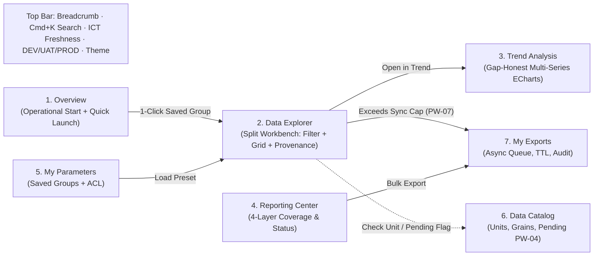

# UX/UI Design Specification — Solar Data Platform Self-Service Portal

> [!NOTE]
> ออกแบบต่อเนื่องจาก [SolarToPI_Production_Portal_New_Chat_Master_Prompt_20261117.md](file:///home/antigravity/SolarToPI_Production_Portal_New_Chat_Master_Prompt_20261117.md) โดยยึดตัวตนภาพลักษณ์จาก `personal-portfolio` (Dark Slate `#020617` + Subtle Cyan/Indigo Atmosphere) ผสานกับแนวคิด **Industrial Precision Workbench** เพื่อตัดกลิ่น "AI Template" ออกให้หมด และรองรับ Workshop Feedback ครบทั้ง 11 ข้อ (`PW-01`–`PW-10`)

---

## 1. แนวคิดหลัก: ทำอย่างไรให้ Dark Slate + Cyan/Indigo ไม่ดูเหมือน "AI สร้าง"?

โทนสีเข้ม + แสงฟุ้ง Cyan/Indigo เป็นโทนที่สวยและทันสมัยมาก แต่ก็เป็นโทนที่เครื่องมือ AI ชอบใช้ซ้ำจนเกิดภาพจำแบบ "AI Dashboard Template" เราแก้ปัญหานี้ด้วยการเปลี่ยน **Grammar ของ Layout และ Surface** จาก *Marketing SaaS* ให้เป็น *Engineering Workbench* (คล้าย Linear, Grafana Enterprise, Stripe Workbench):

| จุดที่ทำให้ดู "AI Template" (ห้ามใช้) | แนวทางออกแบบที่เลือกใช้ ("Industrial Precision Workbench") |
|---|---|
| **4 กล่อง KPI การ์ดเท่ากันทุกหน้า** มีไอคอนวงกลมเรืองแสง + ตัวเลขโตๆ + ป้าย `+12.4%` | **Precision Telemetry Ribbon** แถบแนวนอนเดียวคั่นด้วยเส้น 1px hairline แสดง Scope จริง, ชื่อ SQL View, สถานะ Gate A และ Query Cap ไม่มีตัวเลขปลอม |
| **Glassmorphism + ขอบนีออนเรืองแสงทุกการ์ด** ซ้อนการ์ดกลม `rounded-2xl` 3 ชั้น | **Architectural Hairline Surfaces** ใช้พื้นผิวทึบด้าน (Matte Obsidian `#0B1222`) คั่นด้วยเส้นบาง 1px (`rgba(148,163,184,0.13)`) ลดความโค้งเหลือ `6px–8px` เพื่อพื้นที่แสดงตาราง/กราฟสูงสุด |
| **แสง Glow ฟุ้งจัดหลังตารางและกราฟ** จนปวดตาเวลาใช้งานจริง | **Context-Aware Glow Budget**: หน้า `Overview` แสดงแสงฟุ้ง Cyan/Indigo ชัดตาม `personal-portfolio` แต่เมื่อเข้า `Data Explorer`, `Trends`, `Reports` ระบบหรี่ Glow ลงเหลือ **25% อัตโนมัติ** หลังพื้นผิวทึบ |
| **Headline Gradient / ป้ายกระพริบ `● System Live` / Hero ต้อนรับยาวๆ** | **Direct Workspace Header** สูง `48px` ชัดเจนด้วย Breadcrumb, `⌘K` Quick Search, Timezone `ICT (UTC+7)`, Freshness Timestamp และ Environment Tag (`DEV · 127.0.0.1`) |
| **Sidebar ปุ่ม Pill ไล่สีนีออน** | **Grouped Navigation Rail** พับเหลือ Icon Rail (`56px`) ได้เมื่อต้องการดูตารางกว้าง ใช้เส้นตั้ง Cyan หนา `2.5px` ชิดขอบซ้ายแทนปุ่มเรืองแสง |
| **กราฟเส้นโค้งสวยปลอมๆ ที่ลากเชื่อมข้ามค่า `NULL`** | **Gap-Honest Visualization & Explicit `null`**: ตัดเส้นกราฟขาดจริงเมื่อ Telemetry ขาดหาย, แสดงคำว่า *`null`* ตัวเอียงจางในตาราง (ห้ามแทนด้วย `0`) และแยกโซน *Export Limitation* ชัดเจน |

---

## 2. Design System Tokens (Dark Default + True Light Mode)

ไม่ใช้การกลับสีแบบหยาบ (Simple Inversion) แต่แยก Token ชุดเฉพาะสำหรับทั้ง 2 โหมดเพื่อให้ผ่านคอนทราสต์ระดับ **WCAG AA** ทั้งการอ่านตารางและกราฟ:

| Semantic Token | Dark Default (Portfolio Mood) | True Light Mode | บทบาทการใช้งาน |
|---|---|---|---|
| `--bg-base` | `#020617` (Slate-950) | `#F8FAFC` | พื้นฐานชั้นล่างสุดของหน้าจอ |
| `--bg-rail` | `#050B18` | `#F1F5F9` | Sidebar ซ้ายและแถบ Inspector ด้านล่าง |
| `--bg-surface` | `#0B1222` | `#FFFFFF` | พื้นผิวทึบสำหรับตาราง, Query Builder, กราฟ |
| `--bg-surface-elevated` | `#111B30` | `#F8FAFC` | Header ตาราง, Segmented Control, แถบสรุป |
| `--border-hairline` | `rgba(148,163,184,0.13)` | `rgba(15,23,42,0.10)` | เส้นแบ่งโครงสร้างหลัก 1px |
| `--text-primary` | `#F1F5F9` | `#0F172A` | หัวข้อ, ค่าตัวเลขหลัก |
| `--text-secondary` | `#94A3B8` | `#475569` | คำอธิบาย, ชื่อ Source/View |
| `--accent-cyan` | `#06B6D4` / Text `#22D3EE` | `#0891B2` / Text `#0E7490` | Primary Action, Active Rail Indicator |
| `--accent-indigo` | `#6366F1` | `#4F46E5` | Ambient Glow รอง, Series ที่ 2 ในกราฟ |
| `--status-ok` | `#34D399` | `#059669` | Verified / Telemetry Complete |
| `--status-warn` | `#FBBF24` | `#B45309` | Pending Validation (`PW-04`), Export Limitation (`PW-06`), Large Query (`PW-07`) |
| `--status-danger` | `#FB7185` | `#E11D48` | Telemetry Gap (`NULL`), Query Cap Exceeded |

### Typography & Density Rhythm
- **UI Font:** `Inter`, `Noto Sans Thai`, `Segoe UI` (Base `13px`, Table `12px`, Micro-label `11px`)
- **Technical / Data Font:** `JetBrains Mono` พร้อม `font-variant-numeric: tabular-nums` สำหรับ **ทุกตัวเลข, Timestamp, ชื่อ SQL View, Canonical Metric Code และ Row Count** เพื่อให้หลักตัวเลขตรงกันเป๊ะเมื่อสแกนสายตาลงแนวตั้ง
- **Control Height:** Input/Button หลัก `32px–36px` (กระชับแบบเครื่องมือวิศวกรรม ไม่อ้วนเทอะทะแบบ Landing Page)

---

## 3. Information Architecture & Workflow Map



---

## 4. Screen-by-Screen UX Blueprint (ผูกครบ PW-01 ถึง PW-10)

### 4.1 Overview — Daily Operational Landing
- **เป้าหมาย UX:** พาผู้ใช้งานเข้าสู่การทำงานจริงภายใน **1–2 คลิก** โดยไม่โชว์ตัวเลขปลอม (`22 sites` หรือ `GOOD` แบบ synthetic)
- **องค์ประกอบหลัก:**
  1. **Operational Ribbon (แถบเดียว 4 ช่อง):** Authorized Site Scope (`PW-02`), Read Contract Views (`DEV-01`), Open Gate A Flags (`PW-04`/`PW-06`), Query Guardrail (`PW-07`)
  2. **Quick-Launch Parameter Groups (`PW-03`):** คลิกเดียวเปิด `Data Explorer` พร้อมโหลด Site + Parameters + Resolution ที่บันทึกไว้ทันที
  3. **Data Source Contracts Matrix:** แสดง 3 แหล่งข้อมูลจริง (`Huawei FusionSolar`, `SolarEdge PV + Sensor`, `Glow Solar Farm`) พร้อม Supported Grains และขอบเขตความหมายที่ต่างกัน
  4. **Right Rail:** กล่องแจ้งเตือน Gate A Semantic Notices ที่โปร่งใส + สถานะ Async Export ล่าสุด

### 4.2 Data Explorer — IDE-Style Split Workbench (หน้าหลัก)
- **Layout:** แบ่งซ้าย-ขวาแบบเต็มความสูงหน้าจอ (`316px` Query Builder Rail ที่ทึบและคงที่ + พื้นที่ Preview Grid ด้านขวา + แถบ Row Provenance Inspector ด้านล่าง)
- **การแก้ปัญหาจาก Workshop ในระดับ Interaction:**
  - **PW-01 (Dynamic Multi-Resolution):** Segmented Control `5m | 15m | 1h | 1d` ที่ **Disable อัตโนมัติ** พร้อมข้อความอธิบายชัดเจนเมื่อเลือกแหล่งข้อมูลที่ไม่รองรับ เช่น เลือก `Glow Solar Farm` (native `15m`) → ปุ่ม `5m` จะถูกปิดและสลับเป็น `15m` ให้ทันที ห้ามแอบ upsample
  - **PW-02 (All Authorized Sites):** มีสวิตช์ `All Authorized Sites` ชัดเจนพร้อมป้ายกำกับ `Backend ACL`
  - **PW-03 (Saved Parameter Groups):** เลือกโหลดกลุ่ม Personal / Team Shared จากด้านบนสุดของ Query Builder ได้เลย
  - **PW-04 (SolarEdge Irradiance Pending):** เมื่อติ๊กเลือก `se_poa_irradiance` จะขึ้นกล่องเตือนสี Amber Inline ทันทีว่ากำลังรอการยืนยันหน่วยจาก พี่ธี & น้องแป๋ม และคอลัมน์ในตารางจะกำกับ `(Unverified)`
  - **PW-07 (Pre-Flight Query Cost Guardrail):** คำนวณจำนวนแถวและเวลาโดยประมาณแบบ Real-time ทันทีที่เปลี่ยน Site / Resolution / ช่วงเวลา แบ่ง 3 ระดับ:
    - `Safe` (≤ 80k rows): Preview ทันที
    - `Large Query` (80k–300k rows): เตือนสี Amber แนะนำเปลี่ยนเป็น `1h` และจำกัด Preview 500 แถวแรก
    - `Cap Guardrail` (> 300k rows): เตือนสี Rose และบังคับส่ง Full Extract ไปที่ **Async Export Queue** เพื่อปกป้อง `SOLAR-DB`
  - **Row Provenance Inspector:** คลิกแถวใดก็ได้ในตารางเพื่อดู `UTC Timestamp`, `Native Grain`, `SQL View`, และ `Null Policy`

### 4.3 Trend Analysis — Gap-Honest Multi-Series Workbench (`PW-08`)
- สืบทอดชุด Site/Parameter จาก `Data Explorer` ได้ทันที (ในโค้ดจริงใช้ **Apache ECharts** ตามแผน `DEV-04`)
- **กฎภาพกราฟที่สำคัญต่อความน่าเชื่อถือ:**
  1. **Gap-Honest Line Breaking:** เมื่อข้อมูลเป็น `NULL` เส้นกราฟต้องขาดออกจริง พร้อมแถบแนวตั้งโปร่งสีแดงอ่อน `NULL GAP` (ห้ามลากเส้นเชื่อมหลอกตา)
  2. **Export Limitation Overlay Band:** แสดงโซนสี Amber อ่อนทับช่วงเวลาที่ Plant ถูกจำกัดการส่งออก เช่น `13:00–14:15` เพื่อให้อธิบายกราฟหัวตัด (Flat-top) ได้ทันทีโดยไม่ต้องสลับหน้า
  3. **Live Top Crosshair Readout Bar:** แสดงค่าตัวเลขแบบ Monospace ที่หัวกราฟแทน Tooltip ลอยที่ชอบบังเส้นกราฟ

### 4.4 Reporting Center — 4-Layer Coverage Semantics (`PW-06` / Feedback #6 & #7)
- ออกแบบตารางรายงานที่ **แยก 4 มิติออกจากกันอย่างเด็ดขาด** เพื่อตอบคำถามเรื่อง `Loss of Export Limitation` โดยไม่ Hardcode ตัวเลขหลอก:
  1. **Telemetry Coverage (%):** อัตราการได้รับข้อมูลจริงเทียบจำนวน Bucket (เช่น `100.0%` พร้อม micro-bar)
  2. **Inverters Running:** จำนวน Inverter ที่ทำงานจริงเทียบทั้งหมด (เช่น `8 / 12 units`)
  3. **Operational Condition:** สถานะการเดินเครื่องพร้อมหมายเหตุ (เช่น `FULL · Export Limitation Active` แยกจาก `GAP · 3 Null Buckets`)
  4. **Quality & Provenance:** สถานะความพร้อมของชุดข้อมูลและคำเตือน `Pending PW-04`

### 4.5 My Parameters, Data Catalog & My Exports
- **My Parameters (`PW-03`):** จัดการกลุ่ม Personal และ Team Shared พร้อมป้ายสิทธิ์ ACL และปุ่ม `Open in Explorer →`
- **Data Catalog (`PW-04`, `PW-10`):** พจนานุกรม Canonical Metric เดียวกันทั้ง Portal / Power BI / PI Vision แสดง Raw Mapping, Unit, Supported Grains, Aggregation Method และชื่อ SME ผู้รับผิดชอบ
- **My Exports:** คิวงาน Async พร้อม Progress, TTL Countdown, ปุ่ม Cancel และ Audited Authenticated Download (ไม่มี Public URL)

---

## 5. System State Matrix (มาตรฐานสถานะทุกหน้าจอ)

| สถานะ | รูปแบบการแสดงผล (Visual Contract) |
|---|---|
| **Loading** | Structural Skeleton แบบเรียบ (ไม่มี Spinner กลางจอที่ทำให้หน้ากระตุก) คงความสูงแถวตารางเท่าของจริง |
| **Empty / No Filter** | ข้อความสั้นตรงประเด็น + ปุ่ม Quick Action เช่น "Load O&M Morning Check" |
| **Stale / Delayed Data** | ป้าย Amber ที่ Top Bar Freshness พร้อมเวลาจริงล่าสุด (`Last packet: 42m ago`) |
| **Missing Telemetry (`NULL`)** | ตารางแสดง *`null`* ตัวเอียงจาง / กราฟตัดเส้นขาด + แถบ `NULL GAP` |
| **Pending Validation (`PW-04`)** | ป้าย Amber `Pending Validation` กำกับทั้งใน Picker, Table Header และ Catalog |
| **No Permission (RBAC)** | แสดงข้อความสิทธิ์ที่ขาดและชื่อ Role/Scope ที่ต้องการ (ไม่ซ่อนเงียบจนผู้ใช้สับสนว่าบั๊ก) |
| **Query Cap Exceeded (`PW-07`)** | แสดงตัวเลขประมาณการ + ทางเลือก "Preview Top 500" หรือ "Send to Async Export Queue" |

---

## 6. แผนเชื่อมต่อไปสู่โค้ดจริงใน `DEV-02` (`frontend/`)

โครงสร้าง Component สำหรับ **React 19 + TypeScript + Vite + Tailwind CSS v4 + Lucide + Apache ECharts** ให้เริ่มจากขนาดเล็กและไม่ Over-engineer:

```text
frontend/src/
├── styles/
│   └── tokens.css              # CSS variables (Dark Default + True Light Mode)
├── components/
│   ├── layout/
│   │   ├── AppShell.tsx        # Ambient glow controller (overview vs dense) + Rail + TopBar
│   │   ├── NavigationRail.tsx  # Collapsible grouped sidebar
│   │   └── CommandPalette.tsx  # Cmd+K quick jump (Catalog / Sites / Saved Groups)
│   ├── data/
│   │   ├── TelemetryRibbon.tsx # Hairline horizontal readiness strip
│   │   ├── QueryGuardrail.tsx  # Live row estimator & PW-07 warning banner
│   │   ├── DataGrid.tsx        # Sticky tabular-nums grid with explicit NULL rendering
│   │   └── ProvenanceBar.tsx   # Click-to-inspect SQL view / UTC / grain footer
│   └── charts/
│       └── GapHonestTrend.tsx  # Apache ECharts wrapper (connectNulls: false + markArea)
└── features/
    ├── overview/
    ├── explorer/
    ├── trends/
    ├── reports/
    ├── groups/
    ├── catalog/
    └── exports/
```

> [!TIP]
> ใน **Apache ECharts** สำหรับหน้า Trend Analysis ต้องตั้งค่า `connectNulls: false` เป็นค่าเริ่มต้นในทุก Series และใช้ `markArea` สำหรับวาดโซน `Telemetry Gap` กับ `Export Limitation Active` เพื่อให้สอดคล้องกับกฎ **Gap-Honest Visualization** 100%
